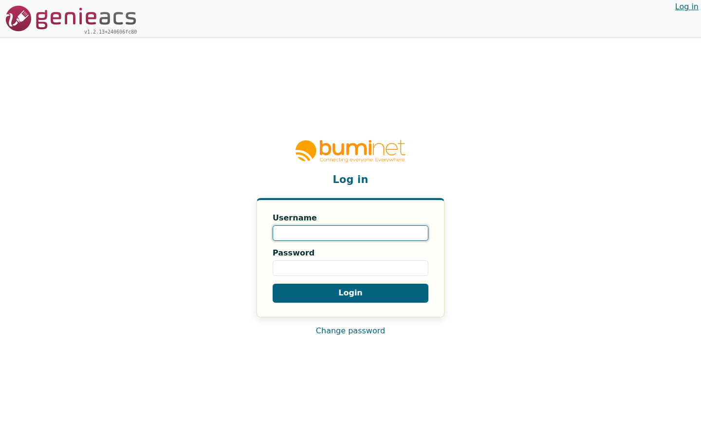
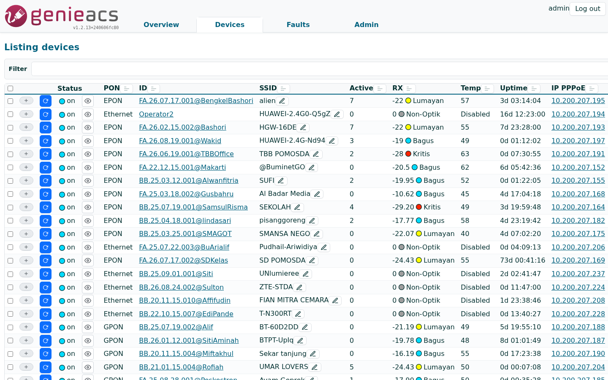
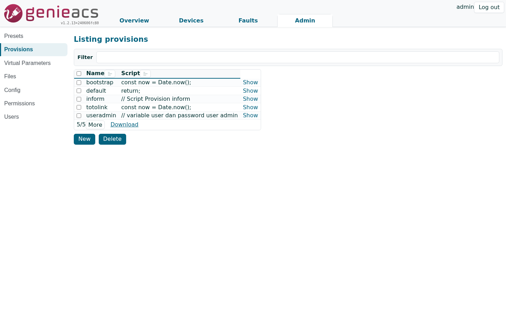
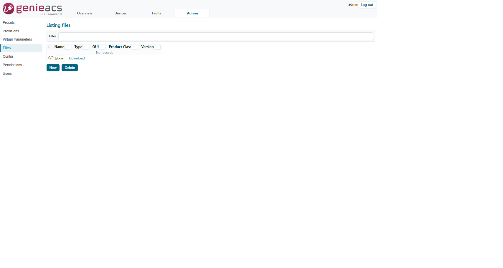
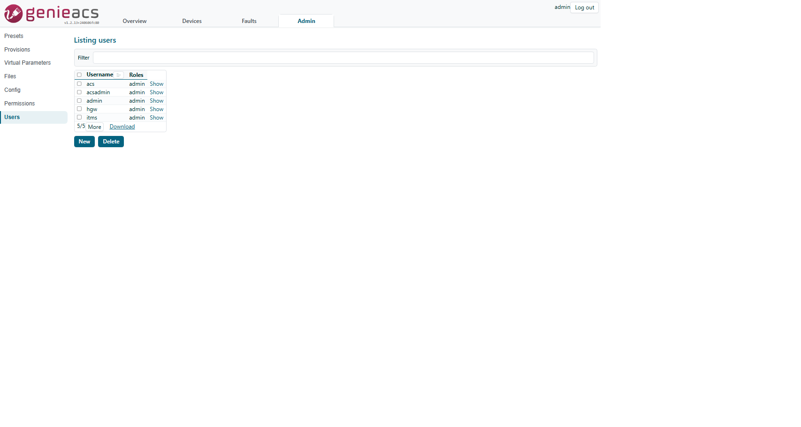

# genieacs-jatim-vers-2026 — Installer GenieACS (ONT/ONU)

Installer & template **GenieACS 1.2.13** (Jatim, 2026) untuk memudahkan admin jaringan mengelola/memonitor perangkat **ONT/ONU (TR-069/CWMP)**. Repo ini menyertakan installer otomatis, konfigurasi (preset/provision/virtual parameter), kustomisasi UI, dan skrip operasional.

> **Target:** Ubuntu Server **22.04 LTS** (disarankan). Jalankan sebagai `root` (atau `sudo`).

## Instalasi cepat

Cukup update server Ubuntu, salin repo, lalu jalankan installer:

```bash
# 1) Update server
sudo apt update && sudo apt upgrade -y
sudo reboot   # jika kernel/paket inti diperbarui (opsional tapi disarankan)

# 2) Ambil installer
sudo apt install -y git
git clone https://github.com/wakidanwar/genieacs-jatim-vers-2026.git
cd genieacs-jatim-vers-2026

# 3) Install & jalankan
sudo bash install.sh
```

Installer akan (idempoten/bisa diulang bila aman): memasang dependensi & layanan (**MongoDB 8**, **Node.js 22**, **GenieACS 1.2.13**), menyiapkan environment/systemd, mengimpor konfigurasi dari `db/*.ndjson`, menerapkan kustomisasi UI, lalu menjalankan semua service.

Saat berjalan, installer meminta nilai penting:
- **IP/hostname ACS** yang dapat dijangkau CPE/ONT (untuk ACS URL/CWMP `:7547`)
- **Kredensial Connection Request** (CPE) — username & password
- **Kredensial admin perangkat** (provision `useradmin`)
- **User & password admin UI** GenieACS

`GENIEACS_UI_JWT_SECRET` dibuat otomatis (acak). Setelah selesai, buka **`http://<IP-ACS>:3000/`** dan login dengan user admin UI yang Anda buat.

### Instalasi non-interaktif (opsional)

Untuk otomatisasi, set variabel lingkungan lalu jalankan dengan `--noninteractive`:

```bash
sudo ACS_HOST=192.168.1.10 \
     CONNREQ_USER=acs CONNREQ_PASS='rahasia-cr' \
     DEVICE_USER=user DEVICE_PASS='rahasia-perangkat' \
     UI_ADMIN_USER=admin UI_ADMIN_PASS='rahasia-ui' \
     TZ=Asia/Jakarta \
     bash install.sh --noninteractive
```

Variabel: `ACS_HOST`, `CONNREQ_USER`, `CONNREQ_PASS`, `DEVICE_USER`, `DEVICE_PASS`, `UI_ADMIN_USER`, `UI_ADMIN_PASS` (wajib di mode non-interaktif), `TZ` (default `Asia/Jakarta`), `GENIEACS_UI_JWT_SECRET` (opsional, default acak), `GENIEACS_VERSION` (default `1.2.13`), `NODE_MAJOR` (default `22`), `DB_NAME` (default `genieacs`).

### Setelah instalasi
1. Pastikan CPE/ONT dapat menjangkau **`http://<IP-ACS>:7547`** dan kredensial **Connection Request** di CPE sama dengan yang dikonfigurasi.
2. Atur firewall/security group sesuai kebutuhan (contoh: izinkan `7547` dari jaringan CPE, `3000` dari jaringan admin; batasi `7557`/NBI; **MongoDB jangan diekspos publik**).
3. Akses UI: **`http://<IP-ACS>:3000/`** (Overview/Devices). Lakukan **hard refresh** browser (`Ctrl+F5`) bila tampilan belum mutakhir.

## Apa yang diinstal & dikonfigurasi
- **Layanan:** `mongod`, `genieacs-cwmp` (`:7547`), `genieacs-nbi` (`:7557`), `genieacs-fs`, `genieacs-ui` (`:3000`) via systemd.
- **Konfigurasi GenieACS (DB):** config UI/index/filters/overview/device view & CWMP, presets, provisions, virtual parameters, permissions, files — diimpor dari `db/*.ndjson` (tanpa `users`/`devices`/`tasks`/`faults`/data live).
- **Kustomisasi UI Jatim 2026:** logo, Bootstrap 5.3.3 lokal, tampilan Devices/Overview/Device view/menu, filter, ikon, dll — diterapkan oleh `ui/apply-ui.sh`.
- **Provision penting:** `inform` (ACS URL, Periodic Inform, kredensial Connection Request) & `useradmin` (kredensial admin perangkat) dikonfigurasi sesuai input Anda.

## Isi repository
- [`install.sh`](install.sh) — installer otomatis (Ubuntu 22.04).
- `db/*.ndjson` — sumber konfigurasi untuk impor: `config`, `presets`, `provisions`, `virtualParameters`, `permissions`, `files`. **Tidak** termasuk `users`, `devices`, `tasks`, `faults`, `operations`, `cache`, `locks`.
- `scripts/` — `import-config.py`, `export-config.py`, `configure-provisions.py`, `create-admin-user.py`, `capture-screenshots.mjs`, salinan `provisions/` & `virtualParameters/`.
- `ui/` — aset & kustomisasi UI + [`ui/apply-ui.sh`](ui/apply-ui.sh) (reapply setelah instal/upgrade).
- `env/genieacs.env.example`, `systemd/*.service` — contoh environment & unit systemd.
- `docs/` — [DEPLOY.md](docs/DEPLOY.md), [POST-UPGRADE.md](docs/POST-UPGRADE.md), [NOTES.md](docs/NOTES.md).

## Konfigurasi ulang & administrasi

- **Ubah ACS URL / kredensial Connection Request / kredensial perangkat (provision):**
  ```bash
  sudo python3 scripts/configure-provisions.py \
    --acs-host <IP-ACS> --acs-port 7547 \
    --connreq-user <USER_CR> --connreq-pass '<PASS_CR>' \
    --device-user user --device-pass '<PASS_PERANGKAT>' \
    --db genieacs
  ```
  (Alternatif: edit lewat UI **Admin → Provisions**: `inform`, `useradmin`.)
- **Buat/ubah user admin UI:**
  ```bash
  sudo python3 scripts/create-admin-user.py <username> '<password>' --role admin --db genieacs
  ```
- **Impor ulang konfigurasi template (upsert, aman diulang):** `python3 scripts/import-config.py --dir db` (hindari `--prune` kecuali paham dampaknya).
- **Terapkan ulang kustomisasi UI:** `sudo bash ui/apply-ui.sh` lalu hard refresh browser (`Ctrl+F5`).
- **Environment:** `/opt/genieacs/genieacs.env` (rahasia, mode `600`, owner `genieacs`). Contoh: `env/genieacs.env.example`.
- **Timezone:** `sudo timedatectl set-timezone Asia/Jakarta` lalu restart service bila perlu.

## Pemeliharaan
- **Backup/ekspor konfigurasi:** `python3 scripts/export-config.py db` (periksa diff; **pastikan tidak ada** kredensial/data live sebelum commit/push).
- **Setelah upgrade GenieACS:** upgrade dapat menimpa `public/` (bundle JS/CSS/icon). Terapkan ulang UI: `sudo bash ui/apply-ui.sh` (lihat [docs/POST-UPGRADE.md](docs/POST-UPGRADE.md)). Patch menargetkan bundle GenieACS **1.2.13** (`app-FOJWPRV7.js`, `app-LU66VFYW.css`, `icons-f3d83e74.svg`); versi/bundle berbeda mungkin perlu penyesuaian.
- **Operasional:** status online dipengaruhi Periodic Inform & `cwmp.deviceOnlineThreshold` (30000). TOTOLINK (`ZIONCOM`, N200RE/N300RT) punya guard/preset khusus. Detail: [docs/NOTES.md](docs/NOTES.md).

## Informasi server (lingkungan sumber)

Template/installer ini disiapkan dari lingkungan berikut (sesuaikan IP/hostname/URL/credential saat deploy di server lain):

| Komponen | Detail |
|---|---|
| Hostname / IP | `genieacs` / `172.16.20.8` (`eth0`) |
| OS | Ubuntu 22.04.5 LTS (Jammy), x86-64 |
| Kernel / Virtualisasi | Linux 6.8.12-15-pve, LXC (Proxmox VE) |
| Timezone | Asia/Jakarta (WIB, UTC+7) |
| GenieACS | 1.2.13+240606fc80 |
| Node.js / npm | v22.23.4 / 10.9.9 |
| MongoDB | 8.0.34 (database `genieacs`) |
| Port | UI `:3000`, CWMP `:7547`, NBI `:7557` |

## Screenshot halaman

Tangkapan layar UI GenieACS (kustomisasi Jatim 2026). Simpan/replace PNG di `docs/screenshots/` agar tampil di README.

| Halaman | Rute | Screenshot |
|---|---|---|
| Login | `#!/login` |  |
| Overview | `#!/overview` |  |
| Devices | `#!/devices` |  |
| Device detail | `#!/devices/<DEVICE_ID>` |  |
| Faults | `#!/faults` |  |
| Admin | `#!/admin` |  |
| Presets | `#!/admin/presets` |  |
| Provisions | `#!/admin/provisions` |  |
| Virtual Parameters | `#!/admin/virtualParameters` |  |
| Config | `#!/admin/config` |  |
| Files | `#!/admin/files` |  |
| Users | `#!/admin/users` |  |
| Permissions | `#!/admin/permissions` |  |

> Catatan: screenshot dapat berisi data/perangkat dari lingkungan sumber dan tampilannya bergantung pada data/kustomisasi. Jika gambar belum muncul di GitHub, file PNG belum ditambahkan ke `docs/screenshots/`.

## Lisensi & sumber
Template ini berisi konfigurasi/kustomisasi untuk [GenieACS](https://genieacs.com) (AGPL-3.0). Sesuaikan penggunaan/pelampiran lisensi dengan kebutuhan distribusi Anda.
