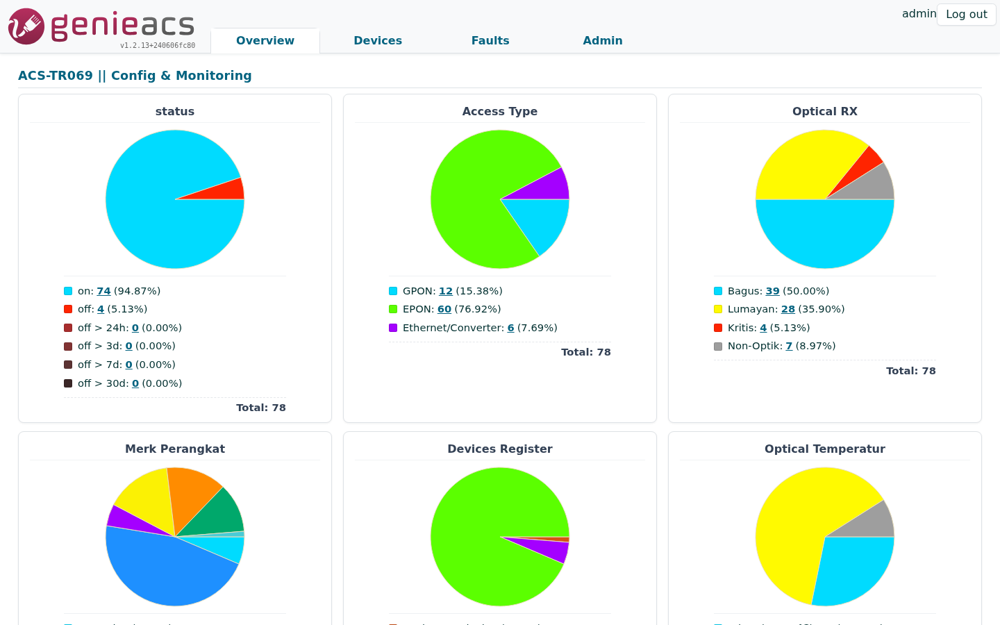
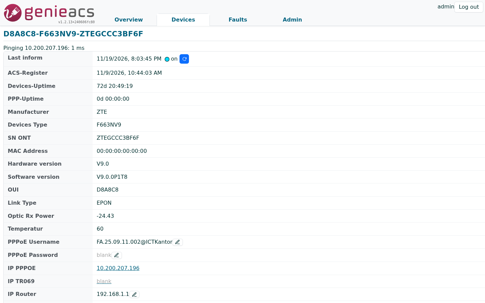
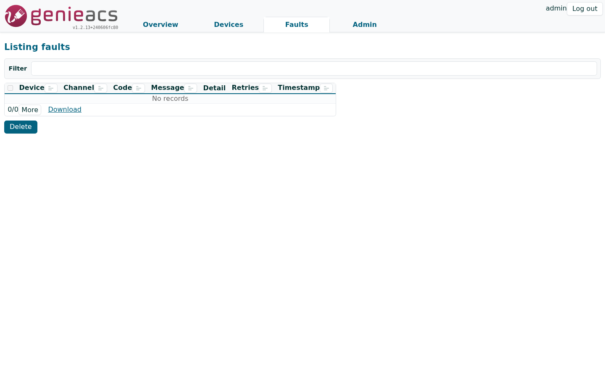
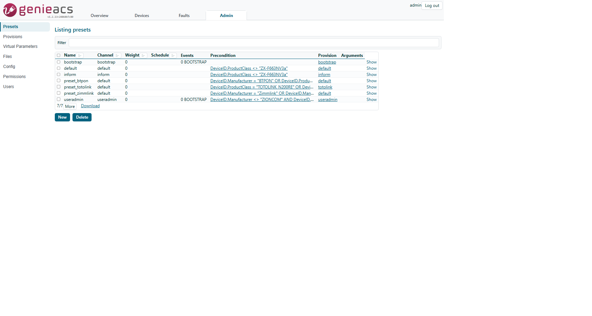
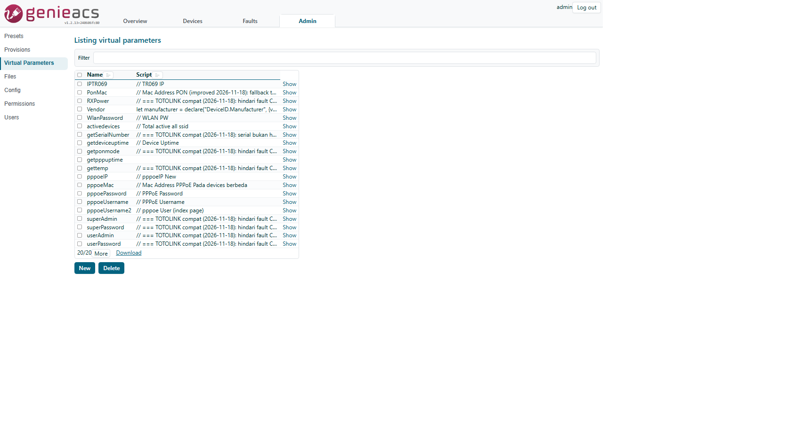
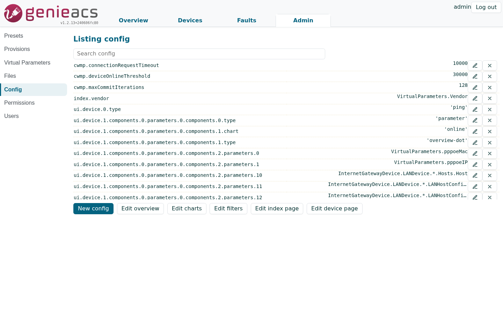
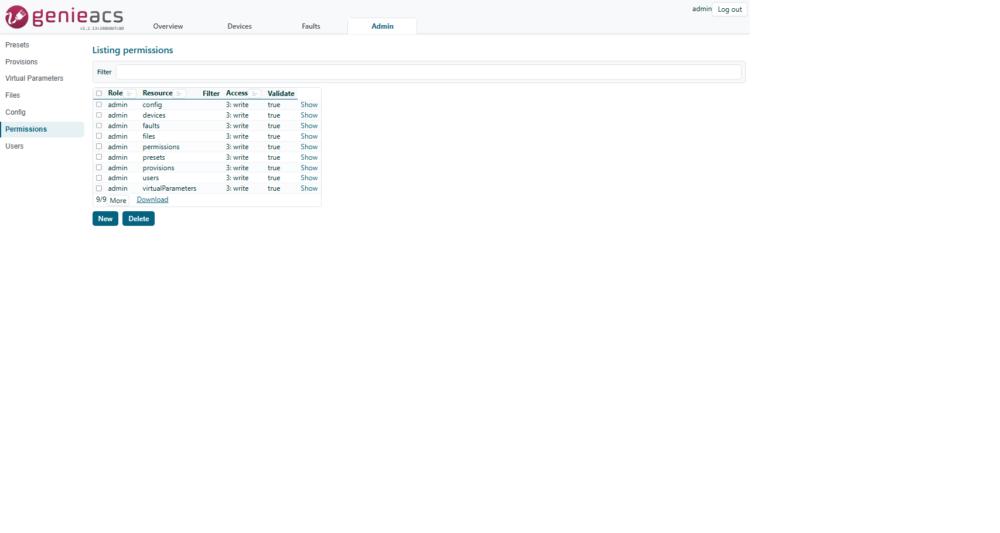

# genieacs-jatim-vers-2026

Template konfigurasi **GenieACS 1.2.13** (Jatim, 2026) — config/preset/provision/virtual parameter, kustomisasi UI, dan panduan deploy.

> **Sebelum dipakai:** siapkan prasyarat, lalu **wajib** sesuaikan nilai spesifik lingkungan (ACS URL, kredensial Connection Request, password provision, `GENIEACS_UI_JWT_SECRET`, timezone, user UI) sebelum produksi. Detail tambahan: [docs/DEPLOY.md](docs/DEPLOY.md), [docs/POST-UPGRADE.md](docs/POST-UPGRADE.md), [docs/NOTES.md](docs/NOTES.md).

## Informasi server (lingkungan sumber)

Template ini disiapkan dari server/lingkungan berikut:

| Komponen | Detail |
|---|---|
| Hostname | `genieacs` |
| IP (ACS host) | `172.16.20.8/24` (`eth0`) |
| OS | Ubuntu 22.04.5 LTS (Jammy Jellyfish) |
| Kernel / Arsitektur | Linux 6.8.12-15-pve, x86-64 |
| Virtualisasi | LXC container (Proxmox VE) |
| Timezone | Asia/Jakarta (WIB, UTC+7) |
| GenieACS | 1.2.13+240606fc80 |
| Node.js / npm | v22.23.4 / 10.9.9 |
| MongoDB | 8.0.34 (`mongod`, database `genieacs`) |
| Services (systemd) | `genieacs-ui`, `genieacs-cwmp`, `genieacs-nbi`, `genieacs-fs`, `mongod` |
| Port | UI `:3000`, CWMP `:7547`, NBI `:7557` |

> Catatan: IP/hostname di atas adalah lingkungan sumber. Saat deploy di server lain, sesuaikan `env/genieacs.env`, provision `inform` (URL ACS & kredensial Connection Request), user UI, dan pengaturan jaringan/firewall.

## Isi repository
- `db/*.ndjson` — ekspor konfigurasi (impor = sumber kebenaran): `config` (UI/index/filters/overview/device view, cwmp), `presets`, `provisions`, `virtualParameters`, `permissions`, `files`. **Tidak** termasuk `users`, `devices`, `tasks`, `faults`, `operations`, `cache`, `locks` (data live/kredensial).
- `scripts/provisions/*.js`, `scripts/virtualParameters/*.js` — salinan skrip (readable) dari koleksi DB.
- `ui/` — aset & kustomisasi UI (logo, Bootstrap 5.3.3, icon `view`, CSS/patch JS/DB) + [`ui/apply-ui.sh`](ui/apply-ui.sh) (reapply setelah instal/upgrade).
- `env/genieacs.env.example`, `systemd/*.service` — contoh environment & unit systemd.
- `scripts/export-config.py`, `scripts/import-config.py` — ekspor/impor konfigurasi via `mongosh` (upsert).
- `docs/` — [DEPLOY.md](docs/DEPLOY.md), [POST-UPGRADE.md](docs/POST-UPGRADE.md), [NOTES.md](docs/NOTES.md).

## Persiapan sebelum instalasi

### 1) Sistem & akses
- Server/VM/LXC dengan **Ubuntu 22.04 LTS** (disarankan, sesuai lingkungan sumber) dan akses `root`/`sudo`.
- Waktu server disarankan **Asia/Jakarta (WIB, UTC+7)**.
- Pastikan server dapat dijangkau oleh CPE/ONU (untuk CWMP) dan, bila memakai on-demand connection request, ACS dapat menjangkau CPE sesuai metode yang didukung.

### 2) Perangkat lunak (versi disarankan)
- **MongoDB 8.x** berjalan sebagai service `mongod` (database: `genieacs`).
- **Node.js 22.x** + **npm**.
- **GenieACS 1.2.13+240606fc80** (`npm install -g genieacs@1.2.13`). *Penting:* patch UI di repo ini menargetkan bundle `app-FOJWPRV7.js`, `app-LU66VFYW.css`, `icons-f3d83e74.svg` (1.2.13). Versi/bundle berbeda dapat memerlukan penyesuaian patch.
- **Python 3**, **mongosh**, **git**, **curl** (untuk impor/ekspor config, apply UI, verifikasi).

### 3) Jaringan & port
- **UI:** TCP `3000` (akses web admin).
- **CWMP (TR-069, CPE):** TCP `7547` (wajib dapat dijangkau CPE).
- **NBI (API):** TCP `7557` (batasi akses; hanya untuk integrasi/admin tepercaya).
- **MongoDB** sebaiknya hanya listen lokal/internal, **tidak** diekspos ke publik.
- Siapkan firewall/security group sesuai kebutuhan (contoh: izinkan 7547 dari jaringan CPE, 3000/7557 dari jaringan admin).

### 4) Informasi yang harus disiapkan (wajib sebelum produksi)
- **IP/hostname ACS** yang dapat dijangkau CPE (dipakai sebagai URL ACS pada port 7547).
- **Kredensial Connection Request** (username/password) yang **kuat** dan **konsisten** antara ACS (provision `inform`) dan pengaturan CPE.
- **Kredensial admin perangkat** (untuk provision `useradmin`) sesuai kebijakan.
- **`GENIEACS_UI_JWT_SECRET`**: string acak panjang & unik (jangan pakai placeholder).
- **Akun user UI GenieACS** (admin) — koleksi `users` tidak diimpor oleh template.

### 5) Salin repository ke server
```bash
git clone https://github.com/wakidanwar/genieacs-jatim-vers-2026.git
cd genieacs-jatim-vers-2026
```
> Sebelum commit/push perubahan kembali ke repo: pastikan tidak ada kredensial/secret/data live (env asli, `db/users`, device/fault/task). Lihat `.gitignore` dan [docs/DEPLOY.md](docs/DEPLOY.md).

## Tata cara instalasi & konfigurasi

> Jalankan perintah dari root repository ini kecuali disebutkan lain. Sesuaikan path/user bila instalasi Anda berbeda.

### Langkah 1 — Pasang MongoDB & Node.js
Pasang MongoDB 8.x dan Node.js 22.x sesuai dokumentasi resmi distro/vendor, lalu verifikasi:
```bash
sudo systemctl enable --now mongod
mongod --version | head -2
node -v && npm -v
```

### Langkah 2 — Pasang GenieACS 1.2.13
```bash
sudo npm install -g genieacs@1.2.13
id genieacs || sudo useradd --system --no-create-home --user-group genieacs
sudo mkdir -p /opt/genieacs/ext /var/log/genieacs
sudo chown -R genieacs:genieacs /opt/genieacs /var/log/genieacs
```
Pastikan binary tersedia: `/usr/bin/genieacs-cwmp`, `/usr/bin/genieacs-nbi`, `/usr/bin/genieacs-fs`, `/usr/bin/genieacs-ui`.

### Langkah 3 — Konfigurasi environment (wajib)
```bash
sudo cp env/genieacs.env.example /opt/genieacs/genieacs.env
sudo chown genieacs:genieacs /opt/genieacs/genieacs.env
sudo chmod 600 /opt/genieacs/genieacs.env
sudo nano /opt/genieacs/genieacs.env   # atau editor lain
```
- Ganti `GENIEACS_UI_JWT_SECRET` dengan nilai **acak panjang & unik**.
- (Opsional) sesuaikan path log / `GENIEACS_EXT_DIR`.

Contoh isi (`env/genieacs.env.example`): path access log CWMP/NBI/FS/UI, `GENIEACS_DEBUG_FILE`, `GENIEACS_EXT_DIR`, `GENIEACS_UI_JWT_SECRET`.

### Langkah 4 — Pasang & jalankan service (systemd)
```bash
sudo cp systemd/*.service /etc/systemd/system/
sudo systemctl daemon-reload
sudo systemctl enable --now genieacs-cwmp genieacs-nbi genieacs-fs genieacs-ui
sudo systemctl status genieacs-cwmp genieacs-nbi genieacs-fs genieacs-ui --no-pager
```

### Langkah 5 — Impor konfigurasi ke MongoDB
Impor bersifat *upsert* (aman diulang). Butuh `mongosh` dan akses lokal ke database `genieacs`.
```bash
python3 scripts/import-config.py --dir db
```
- Impor hanya koleksi template: `config`, `presets`, `provisions`, `virtualParameters`, `files`, `permissions`.
- Opsi `--only` untuk koleksi tertentu (mis. `--only provisions`). **Hindari `--prune`** kecuali Anda paham dampaknya (menghapus entri yang tidak ada di file).

### Langkah 6 — Konfigurasi wajib sesuai lingkungan
Lakukan **sebelum** dipakai produksi:

1. **Provision `inform` — URL ACS & kredensial Connection Request (kritis)**  
   - Placeholder di template: `url = "http://<ACS_HOST>:7547"`, `ConnReqUser = "<CONNREQ_USER>"`, `ConnReqPass = "<CONNREQ_PASS>"`.
   - Ganti `<ACS_HOST>` dengan IP/hostname ACS yang dapat dijangkau CPE, dan set kredensial CR yang kuat & konsisten dengan CPE.
   - Cara ubah: edit `db/provisions.ndjson` (entri `_id:"inform"`) lalu `python3 scripts/import-config.py --dir db --only provisions`, **atau** ubah setelah impor lewat UI: **Admin → Provisions → `inform`**.

2. **Provision `useradmin` — kredensial admin perangkat**  
   - Placeholder: `userpw = "<USER_PASSWORD>"`, `superpw = "<SUPER_PASSWORD>"` (username default `user`; superAdmin dinonaktifkan di template). Ganti sesuai kebijakan: edit `db/provisions.ndjson` (entri `_id:"useradmin"`) lalu impor `--only provisions`, atau ubah lewat UI **Admin → Provisions → `useradmin`**.

3. **Timezone server & restart service**
   ```bash
   sudo timedatectl set-timezone Asia/Jakarta
   sudo systemctl restart genieacs-cwmp genieacs-nbi genieacs-fs genieacs-ui mongod
   ```

4. **Buat user UI GenieACS (admin)** — tidak diimpor oleh template  
   Buat user sesuai CLI/versi GenieACS yang terpasang (contoh, sesuaikan):
   ```bash
   genieacs-ui --help | grep -i user || true
   # jika tersedia: sudo -u genieacs genieacs-ui create-user <username> <password> admin
   ```
   Pastikan role `admin` memiliki permission (sudah diimpor di `db/permissions.ndjson`).

5. **Jaringan/CPE**: pastikan CPE dapat reach `http://<ACS_HOST>:7547`, kredensial Connection Request konsisten, dan aturan firewall mengizinkan port yang diperlukan (3000/7547/7557 sesuai kebijakan).

### Langkah 7 — Terapkan kustomisasi UI
```bash
sudo bash ui/apply-ui.sh
```
- Idempoten; membuat backup bundle di `/root/backups/genieacs-ui-reapply-*` dan me-restart `genieacs-ui`.
- Setelah selesai, buka UI dan lakukan **hard refresh** browser (`Ctrl+F5`) agar CSS/JS baru termuat.

### Langkah 8 — Verifikasi
```bash
systemctl is-active mongod genieacs-cwmp genieacs-nbi genieacs-fs genieacs-ui
curl -s -o /dev/null -w '%{http_code}\n' http://127.0.0.1:3000/
mongosh genieacs --quiet --eval 'printjson({config:db.config.countDocuments(), presets:db.presets.countDocuments(), provisions:db.provisions.countDocuments(), vparams:db.virtualParameters.countDocuments(), perms:db.permissions.countDocuments()})'
```
Akses `http://<ACS_HOST>:3000/` (Overview/Devices), login dengan user UI yang dibuat, dan pastikan CPE dapat inform/online.

## Pemeliharaan
- **Backup/ekspor konfigurasi (template):** setelah perubahan yang ingin disimpan,
  ```bash
  python3 scripts/export-config.py db
  ```
  Periksa diff dan pastikan **tidak ada** kredensial/data live sebelum commit/push.
- **Setelah upgrade GenieACS:** upgrade dapat menimpa `public/` (bundle JS/CSS/icon). Terapkan ulang UI: `sudo bash ui/apply-ui.sh` (lihat [docs/POST-UPGRADE.md](docs/POST-UPGRADE.md)). Jika bundle berubah signifikan, sesuaikan patch di `ui/patches` & `ui/scripts`.
- **Catatan operasional:** CWMP `:7547`, NBI `:7557`, UI `:3000`; status online dipengaruhi Periodic Inform & `cwmp.deviceOnlineThreshold` (30000). TOTOLINK (`ZIONCOM`, N200RE/N300RT) memiliki guard/preset khusus. MongoDB jangan diekspos publik. Detail: [docs/NOTES.md](docs/NOTES.md).

## Screenshot halaman

Tangkapan layar UI GenieACS (kustomisasi Jatim 2026). Simpan file PNG ke `docs/screenshots/` dengan nama berikut agar tampil di README.

| Halaman | Rute | Screenshot |
|---|---|---|
| Login | `#!/login` |  |
| Overview | `#!/overview` |  |
| Devices | `#!/devices` |  |
| Device detail | `#!/devices/<DEVICE_ID>` |  |
| Faults | `#!/faults` |  |
| Admin | `#!/admin` |  |
| Presets | `#!/admin/presets` |  |
| Provisions | `#!/admin/provisions` |  |
| Virtual Parameters | `#!/admin/virtualParameters` |  |
| Config | `#!/admin/config` |  |
| Files | `#!/admin/files` |  |
| Users | `#!/admin/users` |  |
| Permissions | `#!/admin/permissions` |  |

> Catatan: screenshot dapat berisi data/perangkat dari lingkungan sumber dan tampilannya bergantung pada data/kustomisasi. Jika gambar belum muncul di GitHub, file PNG belum ditambahkan ke `docs/screenshots/`.

## Lisensi & sumber
Template ini berisi konfigurasi/kustomisasi untuk [GenieACS](https://genieacs.com) (AGPL-3.0). Sesuaikan penggunaan/pelampiran lisensi dengan kebutuhan distribusi Anda.
